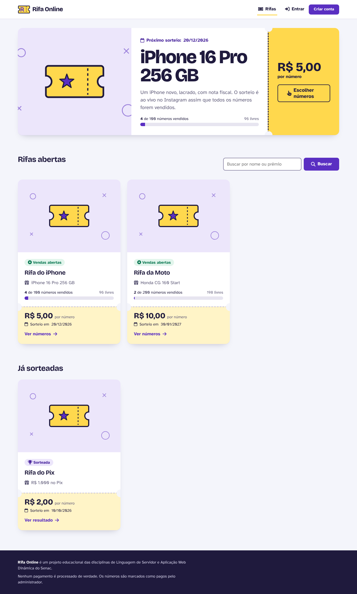
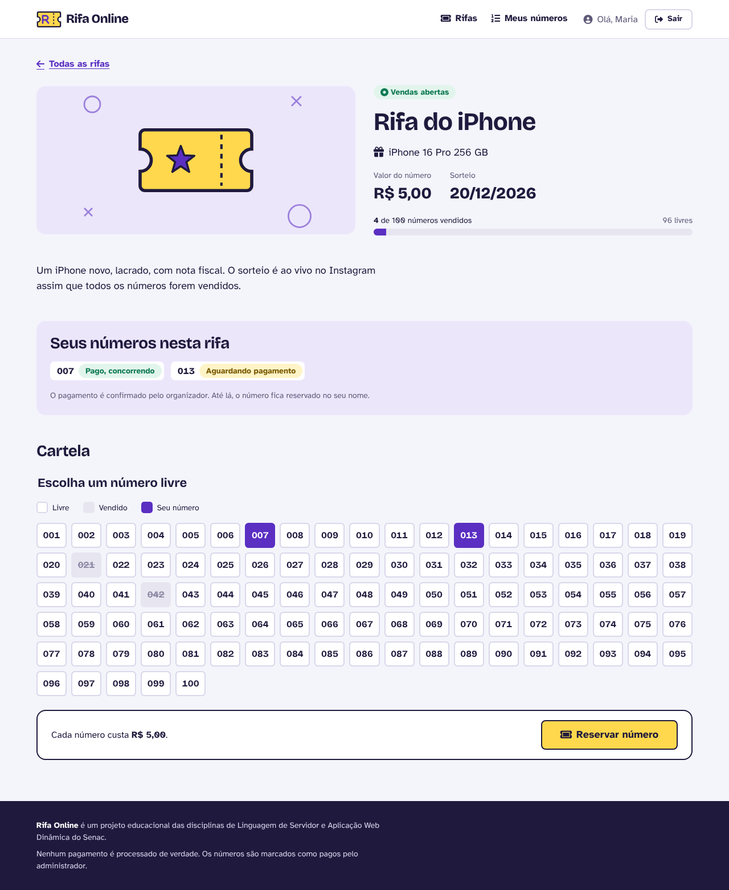
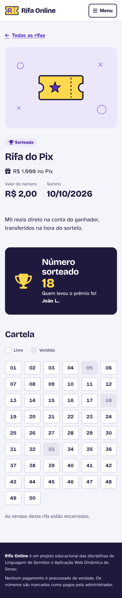
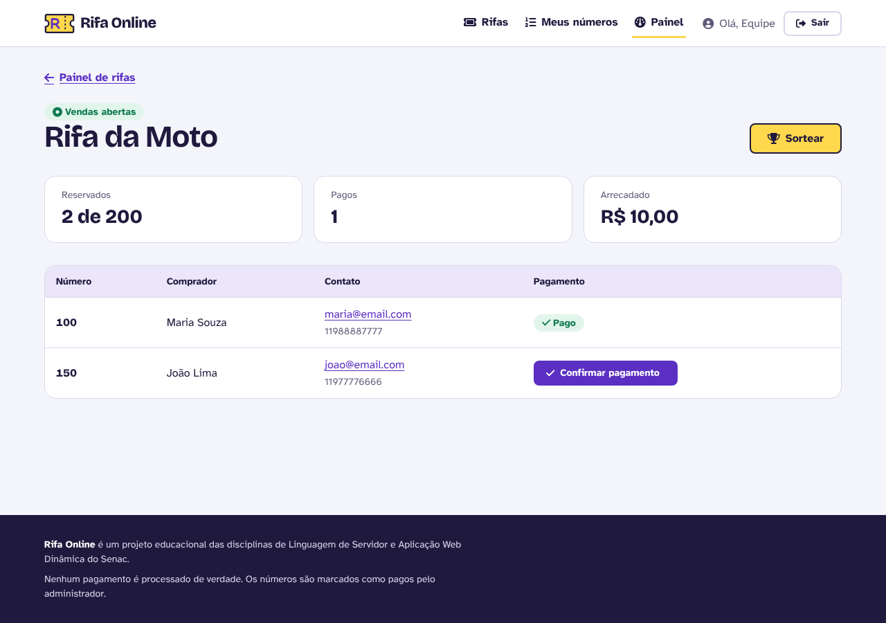
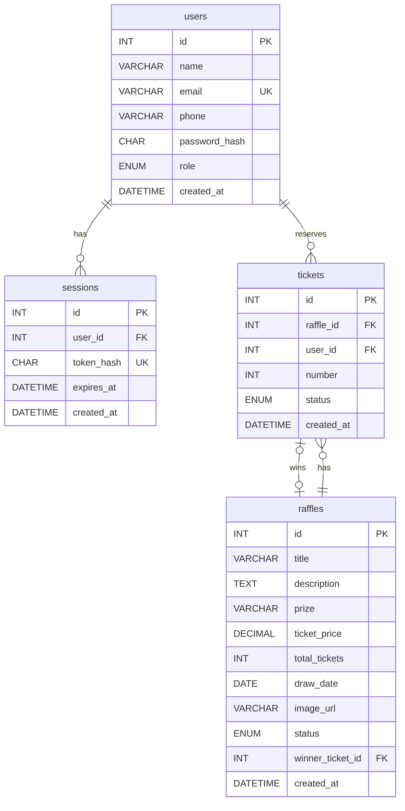

# Rifa Online

Plataforma de rifas online, no estilo das rifas de influenciadores. O administrador cria uma rifa com um prêmio, um valor por número e uma quantidade de números. Quem tem conta escolhe um número na cartela e reserva. Quando o administrador confirma o pagamento, o número entra no sorteio, e no fim o sistema sorteia um ganhador entre os números pagos.

Este é o **projeto de referência da entrega final de Aplicação Web Dinâmica**. É o mesmo projeto do repositório [linguagem-de-servidor](https://github.com/professor-correa/linguagem-de-servidor), agora com telas: o banco, os models e a API são os mesmos, e o servidor passa a responder também páginas HTML.

> Projeto educacional. Nenhum pagamento é processado de verdade: o administrador apenas marca o número como pago. No Brasil, rifas com dinheiro real dependem de autorização do governo.



## Tecnologias

- Node.js com o módulo `http` nativo, sem framework
- MySQL com o driver `mysql2`
- `bcrypt` para as senhas e `dotenv` para as variáveis de ambiente
- HTML gerado no servidor, CSS puro e um único arquivo de JavaScript no navegador, só para o menu do celular
- Font Awesome e Google Fonts por CDN

## Como rodar

### Pré-requisitos

- Node.js 20 ou mais recente
- MySQL 8 (ou MariaDB 10.6 ou mais recente)

### Passo a passo

1. Clone o repositório e instale as dependências:

   ```bash
   git clone https://github.com/professor-correa/aplicacao-web-dinamica.git
   cd aplicacao-web-dinamica
   npm install
   ```

2. Crie o banco rodando no MySQL Workbench, nesta ordem, os arquivos `database/schema.sql` e `database/seed.sql`.

3. Copie o `.env.example` para `.env` e preencha com o usuário e a senha do seu MySQL.

4. Suba o servidor:

   ```bash
   npm run dev
   ```

   Abra `http://localhost:3000` no navegador.

### Usuários de teste

| Papel | Email | Senha |
| --- | --- | --- |
| admin | `admin@rifaonline.dev` | `admin-rifa` |
| customer | `maria@email.com` | `maria-rifa` |
| customer | `joao@email.com` | `joao-rifa` |

## Telas

| Tela | Endereço | Quem acessa |
| --- | --- | --- |
| Início, com a rifa em destaque e a busca | `/` | todos |
| Rifa, com a cartela de números e o resultado | `/raffles/:id` | todos |
| Entrar e criar conta | `/login`, `/register` | quem não entrou |
| Meus números | `/my-tickets` | quem entrou |
| Painel de rifas | `/admin` | administrador |
| Nova rifa e editar rifa | `/admin/raffles/new`, `/admin/raffles/:id/edit` | administrador |
| Confirmar exclusão | `/admin/raffles/:id/delete` | administrador |
| Números vendidos e pagamentos | `/admin/raffles/:id/tickets` | administrador |
| Confirmar sorteio | `/admin/raffles/:id/draw` | administrador |

| Cartela de uma rifa | Resultado no celular |
| --- | --- |
|  |  |



## Banco de dados

O banco é o mesmo de Linguagem de Servidor.



- Um **usuário** pode ter várias **sessões** abertas, uma em cada navegador ou celular.
- A tabela `tickets` liga **usuários** e **rifas**: cada linha é um número reservado por alguém em uma rifa.
- A chave única `(raffle_id, number)` impede que o mesmo número seja vendido duas vezes. Se duas pessoas clicarem no mesmo número ao mesmo tempo, o banco aceita só a primeira, e a segunda vê a mensagem "Esse número acabou de ser reservado por outra pessoa".

## Estrutura de pastas

```txt
database/
  schema.sql
  seed.sql
docs/
  screens/
public/
  css/
  images/
  js/
src/
  server.js
  config/
  routes/
  controllers/
  services/
  models/
  validators/
  views/
  utils/
```

### O que cada parte faz

| Pasta | Responsabilidade |
| --- | --- |
| `public/css` | estilos, separados por assunto (veja abaixo) |
| `public/images` | logo, favicon e a imagem padrão de rifa sem foto |
| `public/js` | o único JavaScript do navegador: abre e fecha o menu no celular |
| `src/routes` | `index.js` decide o tipo de requisição: arquivo da `public`, API em `/api` ou tela. Cada tipo tem seu roteador e sua tabela de rotas |
| `src/controllers` | um controller para a API e outro para as telas. O da API responde JSON; o da tela escolhe uma view ou redireciona |
| `src/services` | regras de negócio usadas pelos dois lados: reservar número, editar, excluir e sortear rifa, login |
| `src/models` | os únicos arquivos com SQL |
| `src/validators` | conferem os dados e devolvem os erros campo por campo |
| `src/views` | funções que recebem dados e devolvem HTML. `layout.js` monta a página inteira e cada view entrega só o miolo |
| `src/utils` | respostas HTTP, cookies, arquivos estáticos, `escapeHtml` e formatação de moeda e data |

### Como uma tela chega ao navegador

```txt
1. o navegador pede GET /raffles/1
2. routes/index.js      não é /public nem /api, então vai para o page-router
3. page-router.js       lê o cookie, descobre quem está logado e acha a rota
4. raffle-page-controller.js  pede a rifa e os números para os models
5. models               fazem as consultas no MySQL
6. views/raffles/raffle-page.js  monta o HTML com os dados
7. o servidor responde o HTML
8. o navegador pede o CSS, as imagens e as fontes, e a pasta public entrega
```

### Por que essa arquitetura

O projeto usa MVC com uma camada de services. A API e as telas fazem as mesmas coisas, só respondem de jeitos diferentes: uma responde JSON, a outra responde HTML ou redireciona. Se a regra de reservar um número ficasse dentro dos controllers, ela estaria escrita duas vezes, e uma correção em um lado poderia ser esquecida no outro.

Com os services, a regra existe em um lugar só. Quando um número já está vendido, `ticketService.reserveTicket` devolve o erro com o código `number-taken`. O controller da API responde `409` com a mensagem em inglês; o controller da tela mostra a cartela de novo com "Esse número acabou de ser reservado por outra pessoa".

## CSS

Os estilos são separados por assunto e carregados nesta ordem pelo `layout.js`:

| Arquivo | Conteúdo |
| --- | --- |
| `reset.css` | zera as diferenças entre navegadores e respeita quem pediu menos animação |
| `variables.css` | cores, fontes, tamanhos de texto, espaçamentos e raios. Nenhum outro arquivo usa cor ou tamanho solto |
| `base.css` | tipografia, links, foco visível, `.sr-only` e link de pular para o conteúdo |
| `layout.css` | container, cabeçalho, menu, rodapé |
| `components.css` | botões, avisos, selos, tabelas, estado vazio |
| `forms.css` | campos, dicas, erros e cartões de formulário |
| `tickets.css` | o bilhete de rifa, a barra de vendas e a cartela de números |
| `admin.css` | números do painel e telas de confirmação |

A identidade visual vem do bilhete de rifa de papel: o cartão de cada rifa tem o canhoto amarelo separado por uma linha picotada, com os recortes nas laterais, e a cartela de números imita a folha onde se marca o número escolhido.

## Acessibilidade

- HTML semântico: `header`, `nav`, `main`, `footer`, `article`, `section` com títulos ligados por `aria-labelledby`
- link "Pular para o conteúdo" no início de toda página
- menu com `aria-current` na página atual e botão do celular com `aria-expanded`. Sem JavaScript, o menu aparece aberto
- todo campo tem `label`. Dicas e erros são ligados ao campo com `aria-describedby`, e o campo com erro recebe `aria-invalid`
- formulário com erro mostra um resumo no topo com `role="alert"` e um link para cada campo
- a cartela é um `fieldset` com `legend`, e cada número é um `radio` de verdade, que funciona pelo teclado
- ícones do Font Awesome usam `<i>` com `aria-hidden="true"` e sempre vêm acompanhados de texto
- foco visível em laranja em todos os elementos, contraste de cor no padrão AA
- tabelas com `caption`, `th` e `scope`
- `prefers-reduced-motion` respeitado no `reset.css`

## Segurança

- **Senhas:** guardadas só como hash, com `bcrypt`.
- **Sessão nas telas:** cookie `HttpOnly` (o JavaScript da página não lê o token) e `SameSite=Lax` (outro site não consegue enviar um formulário com a sessão de quem está logado). No banco fica só o hash do token.
- **SQL Injection:** toda consulta usa `?`.
- **XSS:** todo texto vindo do banco ou do usuário passa por `escapeHtml` antes de entrar no HTML. Uma rifa com `<script>` no título aparece como texto.
- **Redirecionamento:** o `?next=` do login só aceita caminhos do próprio site.
- **Avisos:** a mensagem de "Rifa criada" e afins vem de uma lista fixa (`?notice=raffle-created`), nunca de um texto da URL.
- **Arquivos estáticos:** endereços como `/public/..%2f.env` são bloqueados.
- **Erros:** um erro inesperado mostra uma página genérica, e o detalhe técnico fica só no terminal.

## API

A API de Linguagem de Servidor continua funcionando em `/api`, com as mesmas rotas e o mesmo login por token Bearer. A documentação e a collection do Postman estão no repositório [linguagem-de-servidor](https://github.com/professor-correa/linguagem-de-servidor).

## Referências

MOZILLA. Accessibility. MDN Web Docs. Disponível em: https://developer.mozilla.org/pt-BR/docs/Web/Accessibility. Acesso em: 26 out. 2026.

W3C. Web Content Accessibility Guidelines (WCAG) 2.2. Disponível em: https://www.w3.org/TR/WCAG22/. Acesso em: 26 out. 2026.

OWASP FOUNDATION. Cross Site Scripting Prevention Cheat Sheet. Disponível em: https://cheatsheetseries.owasp.org/cheatsheets/Cross_Site_Scripting_Prevention_Cheat_Sheet.html. Acesso em: 26 out. 2026.

OWASP FOUNDATION. Session Management Cheat Sheet. Disponível em: https://cheatsheetseries.owasp.org/cheatsheets/Session_Management_Cheat_Sheet.html. Acesso em: 26 out. 2026.

MOZILLA. Set-Cookie. MDN Web Docs. Disponível em: https://developer.mozilla.org/pt-BR/docs/Web/HTTP/Headers/Set-Cookie. Acesso em: 26 out. 2026.

NODE.JS. HTTP. Node.js Documentation. Disponível em: https://nodejs.org/api/http.html. Acesso em: 26 out. 2026.

## Declaração de uso de IA

ANTHROPIC. Claude (Opus 5.5). Ferramenta de inteligência artificial generativa.
Data de uso: 26 out. 2026.
Finalidade: apoio na escrita do código, dos testes e da documentação deste projeto de referência, com revisão do professor.
Arquivos impactados: todo o repositório.
